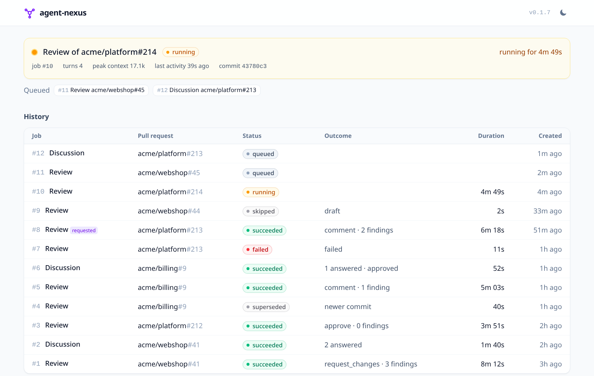
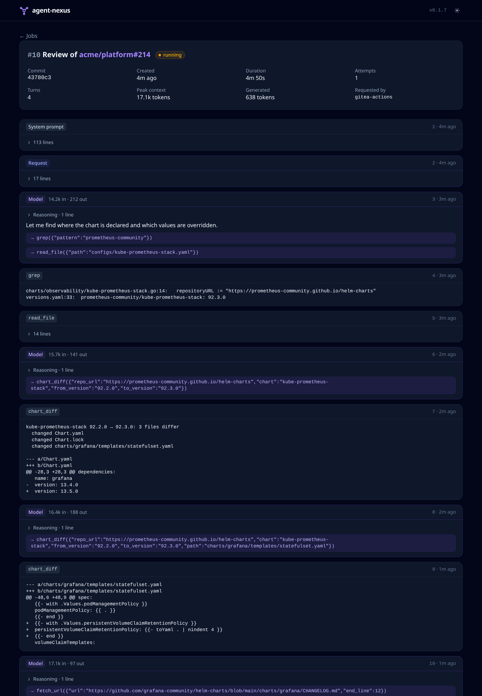

# agent-nexus

agent-nexus listens for events, runs LLM agent jobs against a llama.cpp
`llama-server`, and posts the results back. Version 1 does pull request
reviews on Gitea and GitHub.

```
workflow ──POST /v1/events/pr-review──▶ API (API key, owner allowlist, head check)
                                          │ enqueue (dedupe per commit, supersede older commits)
                                          ▼
                              SQLite job store + worker pool
                                          ▼
          review: fetch PR → git fetch (bare cache) → diff → agent loop
                  (pr-review skill + read-only git tools) → JSON review
                                          ▼
                          PR review with inline comments
```

- **Fire and forget.** The workflow posts an event and exits within seconds.
  agent-nexus queues the job and posts the review as its bot.
- **Only identifiers are trusted.** The workflow sends `server_url`, `repo`,
  `pr` and `head_sha`. agent-nexus reads the pull request from the forge
  itself, and drops events whose `head_sha` is no longer the head.
- **Read-only, sandboxed tools.** The model can call `read_file`,
  `list_dir`, `grep`, `git_log` and `get_file_diff`. They read git objects
  at the head commit and never touch a checkout. Arguments the model
  supplies cannot become git options.
- **Repository guidance.** `AGENTS.md` (or `CLAUDE.md`) is read from the
  *base* branch, so a pull request cannot rewrite its own review rules.
- **Idempotent posting.** Each review carries a hidden marker with the
  commit SHA. A job that is retried, or recovered after a crash, never
  posts twice.
- **Answers replies.** agent-nexus answers replies in its own review threads,
  and comments that mention `@agent-nexus`. Its later reviews take the
  discussion into account (see [Discussion](#discussion)).
- **Comment or verdict, per repository.** By default a review is a plain
  comment. Repositories in verdict mode get an approval, a comment or a
  change request instead (see [Review modes](#review-modes)).
- **A jobs UI.** It shows what runs, the job history, and every step the
  agent took (see [Jobs UI](#jobs-ui)).

The review instructions live in [`skills/pr-review/SKILL.md`](skills/pr-review/SKILL.md),
which uses the Agent Skills format and is embedded in the binary.

## Commands

```sh
agent-nexus serve      # HTTP API + workers
agent-nexus review -forge gitea -repo mycroft/k8s-home -pr 42 -dry-run -transcript
agent-nexus version
```

`review` runs one review synchronously and prints it. With `-dry-run` it
does not post, which makes it the quickest way to iterate on the skill.
Point `SKILLS_DIR=./skills` at the working tree to skip rebuilding.

## Configuration

Everything is configured through environment variables.

| Variable | Default | |
|---|---|---|
| `LLM_BASE_URL` | required | OpenAI-compatible root, e.g. `https://llm-api.iop.cx/v1` |
| `LLM_API_KEY` | | Bearer token for the LLM server |
| `LLM_MODEL` | required | Model name sent with each request |
| `LLM_CONTEXT_TOKENS` | from `/props` | Context window; set it to avoid the startup lookup |
| `LLM_THINKING_BUDGET` | server default | Most reasoning tokens per request (llama-server `thinking_budget_tokens`); `0` keeps the server's default |
| `LLM_CONCURRENCY` | `1` | Parallel jobs; match llama-server `--parallel` |
| `LLM_REQUEST_TIMEOUT` | `10m` | One completion, including time queued in llama-server |
| `AGENT_MAX_TURNS` | `30` | Tool-loop turns per review |
| `JOB_TIMEOUT` | `30m` | One job end to end; the investigation stops early enough to write the review before it |
| `API_KEYS` | required for `serve` | `name=key,name=key`, each key ≥ 32 characters |
| `ALLOWED_OWNERS` | required for `serve` | Comma-separated repository owners |
| `EVENTS_PER_MINUTE` | `30` | Rate limit per API key |
| `REVIEW_MODES` | | Central review mode rules, `pattern=mode,…` (see below) |
| `GITEA_URL`, `GITEA_USER`, `GITEA_TOKEN` | | Gitea forge (bot account) |
| `GITHUB_APP_ID`, `GITHUB_APP_PRIVATE_KEY` | | GitHub forge (App, PEM key) |
| `GITHUB_API_URL`, `GITHUB_SERVER_URL` | github.com | For GitHub Enterprise |
| `LISTEN_ADDR` | `:8080` | API |
| `METRICS_ADDR` | `:9090` | `/metrics`; keep it out of the Ingress |
| `UI_ADDR` | `:8081` | Jobs UI, unauthenticated: expose it only behind an authenticating proxy |
| `DB_PATH` | `agent-nexus.db` | SQLite database |
| `REPO_CACHE_DIR` | `repos` | Bare repository cache |
| `CHART_CACHE_DIR` | `charts` | Helm chart packages and indexes read by the agent |
| `FETCH_ALLOWED_HOSTS` | | Comma-separated hosts the agent may read from (chart repositories, pages, image registries) besides those the reviewed repository references |
| `TRANSCRIPT_RETENTION` | `720h` | How long agent transcripts are kept |
| `SKILLS_DIR` | embedded | Load skills from disk instead |
| `LOG_LEVEL` | `info` | |

At least one forge must be configured.

## Review modes

Each repository is reviewed in one of two modes:

- **`comment`** (the default): the review is a plain comment with a
  summary and findings, and no verdict.
- **`verdict`**: the review is submitted as an approval, a comment or a
  change request, following its verdict. A verdict that contradicts the
  findings is downgraded to a comment, with a note explaining why:
  - approving requires no blocking or important finding;
  - requesting changes requires a blocking finding.

If the forge refuses the verdict, for example because the bot may only
comment, the review is posted as a comment.

The verdict also follows the discussion. Once every finding of the bot's
latest review of the head is settled in replies, it approves the pull
request without a new review (see [Discussion](#discussion)).

The mode comes from the first of these that applies:

1. **A central rule naming the repository exactly.**
2. **`review.mode` in the repository's `.agent-nexus.yaml`**, read from
   the base branch, so a pull request cannot change its own mode.
3. **A central rule with a pattern.** Patterns use `path.Match`, e.g.
   `mycroft/*`.
4. **`comment`.**

Central rules are an ordered list: `REVIEW_MODES`, or `review.modes` in
the Helm chart.

```yaml
# Helm values
review:
  modes:
    - repo: mycroft/k8s-home   # always verdict, whatever its file says
      mode: verdict
    - repo: "mycroft/*"        # others: comment, unless their file says otherwise
      mode: comment
```

```yaml
# .agent-nexus.yaml, at the root of a repository
review:
  mode: verdict
```

When `.agent-nexus.yaml` is invalid, agent-nexus ignores it and says so
in the review.

On Gitea, an approval counts toward branch protection only when the
reviewer has write access or is in the approvals allowlist. A read-only
bot's approvals are shown but are not "official".

## Reading charts, release notes and docs

### Helm charts

Most version-bump PRs change one line, such as
`prometheus-community/kube-prometheus-stack: 92.3.0`. The agent can read
the chart versions themselves:

- `chart_files` lists a version's files;
- `chart_read` reads one file;
- `chart_diff` diffs two versions: which files changed, then their diffs,
  `Chart.yaml` and `values.yaml` first.

A review uses them to check what the repository sets against keys the new
version renamed or removed, changed defaults and new required values.

They read classic Helm repositories (`https://…`, through `index.yaml`,
with the package digest checked) and OCI registries (`oci://…`, with an
anonymous registry token). Subcharts shipped as archives are unpacked
under `charts/<name>/`.

The model chooses the repository URL, so a chart URL is accepted only if:

- **it appears in the reviewed repository's base branch**, which a pull
  request cannot change. The model can only name repositories already in
  use, and cannot carry data out in a URL;
- **or its host is in `FETCH_ALLOWED_HOSTS`**.

### Release notes and pages

- **`release_notes(image, from_version, to_version)`** reads the GitHub
  releases of a container image's project, after `from` up to `to`.
  - It finds the project from the image's
    `org.opencontainers.image.source` label, or from its name for ghcr.io.
  - Versions compare by their numbers, so image tag `v2.5` matches release
    `v2.5.0`.
  - Pre-releases count only when `to` is one.
  - It uses the GitHub API anonymously (60 requests an hour).
- **`fetch_url(url)`** reads a page as text: HTML is converted, markdown and
  plain text are kept. GitHub file links are read from their raw content.
  Pages are cached for 15 minutes, so reading one in parts fetches it once.

What the model may ask for is limited the same way:
- **Images:** the image name must appear in the base branch, matched as a
  whole name: `haals/yopass` doesn't ride on `jhaals/yopass`. Otherwise,
  its registry must be on `FETCH_ALLOWED_HOSTS`.
- **Pages:** the page's host must appear in the base branch, matched as a
  whole hostname: `community.github.io` doesn't ride on
  `prometheus-community.github.io`. Otherwise, it must be on
  `FETCH_ALLOWED_HOSTS`. Query strings are refused.

### Network safety

Every connection, redirects included, must reach a public address, so
neither a URL nor a redirect can reach the cluster, the local network or
the host. No credentials are sent, and proxy settings are ignored.

Chart packages are cached under `CHART_CACHE_DIR` for good, since a published
version doesn't change; indexes are refreshed hourly. Sizes are capped:
32 MB per index, 16 MB per package, and 64 MB or 5000 files once
unpacked. Packages are read in memory, never unpacked to disk.

## Discussion

agent-nexus answers:

- **Replies in an inline thread it took part in.** It answers in the
  thread.
- **Comments that mention `@agent-nexus`.** This covers PR comments,
  review bodies and inline comments. It answers with a PR comment that
  quotes the message.

This works on closed and merged PRs too, for questions about a change
after it landed. The diff then comes from the merge base the forge
recorded, since the base branch now holds the PR. Reviews, review
requests and approvals remain for open PRs: `@agent-nexus review` on a
closed one gets a reply saying so.

It doesn't use the comment that triggered the event. Each pass reads the
whole discussion and answers what is still waiting, so a missed event is
caught up by the next one:

- One answer covers every pending message of a thread.
- Each answer carries a hidden `<!-- agent-nexus:reply-to=… -->` marker,
  so nothing is answered twice.
- At most three conversations are answered per pass.

Answers follow [`skills/pr-discussion/SKILL.md`](skills/pr-discussion/SKILL.md).
The agent checks the reply against the code with the same read-only tools,
then either withdraws the finding or keeps it, with evidence.

A new review also reads the earlier discussion: its previous reviews,
the threads it took part in, and the PR comments. It doesn't repeat a
finding that was answered convincingly or fixed since.

**Settling findings.** Each review lists its findings in a hidden
`<!-- agent-nexus:findings=… -->` marker. An answer says which findings of
the latest review of the head it settles:

- the bot withdrew it;
- the head commit fixes it;
- its author deferred it, and the bot agrees it needn't block the PR.

It records them in a hidden `<!-- agent-nexus:resolves=… -->` marker; only
the bot's own markers count.

In a `verdict` repository, once every finding is settled, agent-nexus
submits an approval: a "verdict update" listing the findings. No new
review runs. It then counts as the latest review, so it is submitted only
once. A new commit, or a requested review, starts over with that review's
findings.

**Asking for another review.** A commit is normally reviewed once. To get
a new review of the current head, do either of these:

- request a review from `agent-nexus` in the PR's reviewers (Gitea);
- comment `@agent-nexus review`, `@agent-nexus review again` or
  `@agent-nexus re-review`.

Either way, the review runs even if that commit was already reviewed. The
comment is answered with the queued job's number, without asking the
model.

**Token scopes.** Reading PR comments needs the Gitea token's `read:issue`
scope; without it, agent-nexus sees review threads only.
- Mentions in PR comments, and those comments in the earlier discussion,
  need `read:issue`.
- Answering mentions with a PR comment needs `write:issue`. Without it,
  agent-nexus answers with a comment-only review instead.

## API

All `/v1` routes require `Authorization: Bearer <api key>`.

- `POST /v1/events/pr-review` takes `{"server_url", "repo", "pr", "head_sha"}`,
  and optionally `"force": true` to review a commit that was already
  reviewed.
  - `202` with `{"job_id"}` when the review is queued.
  - `200` when it is a duplicate of a live or finished job, when the
    event is stale, or when the PR is a draft or closed.
- `POST /v1/events/pr-comment` takes `{"server_url", "repo", "pr"}`. It
  queues a pass over the pull request's discussion, which answers what is
  waiting for the bot.
  - `202` with `{"job_id"}`. A newer event replaces a queued pass; a running
    pass finishes. Closed and merged PRs are discussed too.
- `GET /v1/jobs` lists recent jobs, newest first, with their payload
  (forge, repository, PR) and their progress so far:
  - progress fields: `turns`, `peak_prompt_tokens`, `prompt_tokens`,
    `completion_tokens`, `last_activity`;
  - filters: `?status=running,queued` (comma-separated), `?kind=pr_review`
    or `pr_discussion`, `?limit=20` (at most 100).
- `GET /v1/jobs/{id}` returns the job's status, result or error, and
  token usage.
- `GET /v1/jobs/{id}/steps` returns the agent transcript: prompts, tool
  calls and answers.
- `GET /healthz` needs no key.

## Jobs UI

`UI_ADDR` serves a read-only web UI over the job store:

- the main page shows the running job (turns, peak context, last activity),
  the queued ones, and the job history;
- a job page shows its outcome and every step of the agent transcript:
  prompts, reasoning, tool calls and tool output.

Both pages refresh themselves with htmx while jobs run. The theme follows
the OS until toggled.





The screenshots use demo data.

The UI has no authentication of its own, which is why it has its own
listener: route it through an authenticating proxy (an Authentik outpost,
for instance), on its own host, and keep the API's ingress pointing at
`LISTEN_ADDR` only. The API keeps authenticating with its API keys, so CI
runners reach it without going through the proxy.

## Metrics

These are served on `METRICS_ADDR` at `/metrics`:

| Metric | |
|---|---|
| `agent_nexus_jobs{status}` | Unfinished jobs: `queued`, `running`, `posting` |
| `agent_nexus_job_oldest_seconds{status}` | Age of the oldest unfinished job: since it was queued, or since it started |
| `agent_nexus_jobs_total{kind,status}` | Finished jobs |
| `agent_nexus_job_duration_seconds{kind}` | Job run time |
| `agent_nexus_llm_request_duration_seconds{outcome}` | Chat-completion latency |
| `agent_nexus_llm_tokens_total{type}` | Prompt and completion tokens |
| `agent_nexus_tool_calls_total{tool,outcome}` | Tool calls: `ok`, `error`, `repeat`, `refused` |
| `agent_nexus_forge_errors_total{forge}` | Failed forge API requests |

For example, to alert on a stuck job, compare
`agent_nexus_job_oldest_seconds{status="running"}` with `JOB_TIMEOUT`,
which defaults to 30 minutes.

## Deployment

The Helm chart in [`charts/agent-nexus`](charts/agent-nexus) runs a
single-replica StatefulSet. Its volume holds the SQLite job store and the
repository cache. The pod runs as uid 65532 with a read-only root
filesystem.

```sh
helm install agent-nexus oci://registry.mkz.me/mycroft/charts/agent-nexus \
  --version 0.1.0 -f values.yaml
```

The chart needs an existing Secret, named by `existingSecret`, with these
keys:

- `api-keys` (required)
- `llm-api-key` (optional)
- `gitea-token` (when Gitea is enabled)
- `github-app-private-key` (when GitHub is enabled)

Everything else lives in [`values.yaml`](charts/agent-nexus/values.yaml).
The chart fails to render when a required setting is missing.

The Service has three ports: `http` (the API, which the chart's ingress
routes), `metrics`, and `ui`. The chart never exposes `ui`; give it its own
ingress behind an authenticating proxy (see [Jobs UI](#jobs-ui)).

Pushing a `vX.Y.Z` tag releases both artifacts:

- **Image:** `registry.mkz.me/mycroft/agent-nexus:X.Y.Z`
- **Chart:** `oci://registry.mkz.me/mycroft/charts/agent-nexus` at version
  `X.Y.Z`, whose appVersion points at that image.

## Setup

### llama-server

- The model must support tool calls. `--jinja` is on by default in recent
  builds.
- A context of at least 32k tokens is recommended.
- If a reverse proxy sits in front of llama-server, its timeout must be at
  least `LLM_REQUEST_TIMEOUT`. llama-server queues requests while every
  slot is busy, so a request can wait a long time.

### Gitea

1. **Bot account.** Create an `agent-nexus` bot account (Site
   Administration → User Accounts → Create, user type *Bot*) and give it
   read access to the private repositories. From the bot's admin page,
   create a token with these scopes, then set `GITEA_USER` and
   `GITEA_TOKEN`:
   - `write:repository`, to fetch the code, post reviews and reply in
     threads;
   - `read:user`, to look up its own login;
   - `read:issue`, to read PR comments: mentions, and the earlier
     discussion;
   - optionally `write:issue`, to answer mentions with a PR comment
     instead of a review.
2. **Actions secret.** Add a user-level Actions secret named
   `AGENT_NEXUS_API_KEY` with one of the `API_KEYS` values.
3. **Scoped workflow.** Register
   [`.gitea/scoped_workflows/pr-review.yaml`](.gitea/scoped_workflows/pr-review.yaml)
   under User Settings → Actions → Scoped Workflows. It then runs on every
   repository you own, and a repository can opt out. It sends events to
   two endpoints:
   - pull request events to `pr-review`, including review requests
     addressed to `agent-nexus`, which are sent with `force: true`;
   - comment and review events to `pr-comment`.
4. **GitHub mirror.** Push-mirror this repository to
   `github.com/mycroft/agent-nexus`, so GitHub repositories can use the
   reusable workflow.

### GitHub

1. **Create the App.** Create a GitHub App with these permissions:
   - Contents: read
   - Pull requests: read & write
   - Metadata: read

   No webhook is needed.
2. **Configure agent-nexus.** Install the App on the repositories. Set
   `GITHUB_APP_ID` and `GITHUB_APP_PRIVATE_KEY`.
3. **Per repository.** Add the `AGENT_NEXUS_API_KEY` secret and this
   caller workflow:

```yaml
name: agent-nexus
on:
  pull_request:
    types: [opened, synchronize, reopened, ready_for_review]
  issue_comment:
    types: [created]
  pull_request_review_comment:
    types: [created]
jobs:
  agent-nexus:
    if: ${{ github.event_name != 'pull_request' || !github.event.pull_request.draft }}
    uses: mycroft/agent-nexus/.github/workflows/pr-review.yaml@main
    secrets:
      AGENT_NEXUS_API_KEY: ${{ secrets.AGENT_NEXUS_API_KEY }}
```

## Development

```sh
make test   # go test -race ./...
make lint   # golangci-lint
make build  # also builds the UI stylesheet
make css-watch
make helm-lint
CONTAINER_TOOL=podman make docker-build
```

Tests need `git` on the PATH. `make css` downloads the Tailwind standalone
CLI into `bin/` and writes `internal/web/static/css/app.css`, which is not
committed. htmx is vendored in `internal/web/static/js` (`make vendor-js`
updates it).
